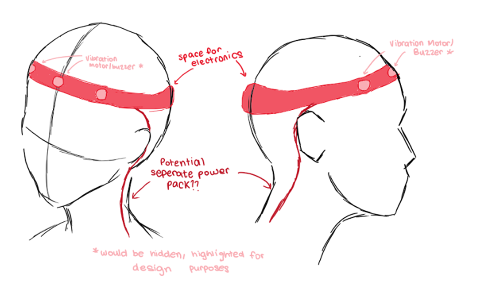
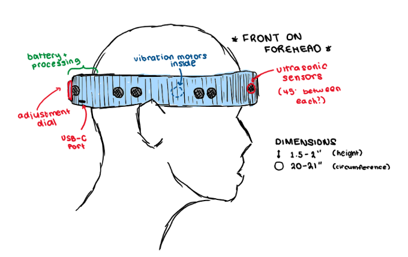
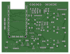
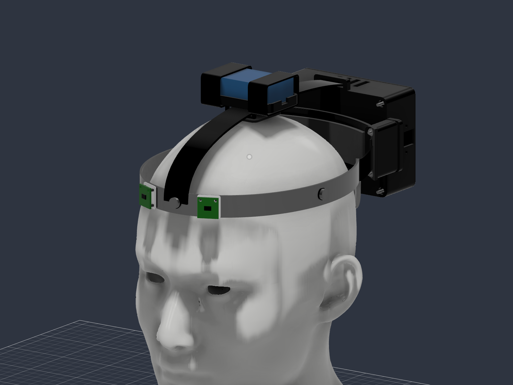
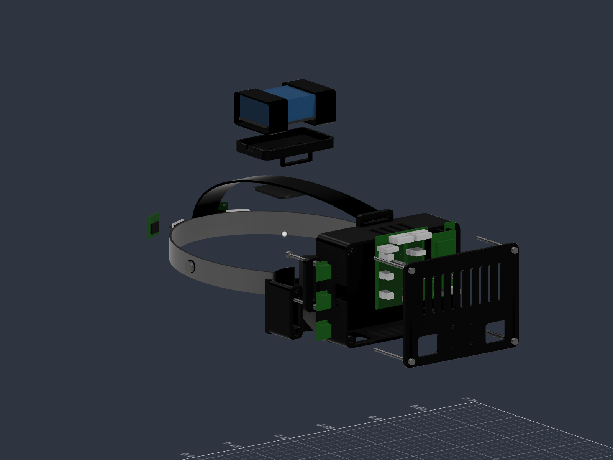

**haptic navigation headband - journal**

**total: about 26 hours**

usually working in the evening, around 7-9, 8-10 or 9-11 pm. the times below are estimates, roughly 2 hrs each.

### 28 september 2026: starting with my client

talked to my client about the idea. he's a relative of mine who lost his sight through optic nerve atrophy, which is why i wanted to do this in the first place.

thinking of a wearable that uses vibrations to tell him about nearby obstacles. nothing built yet, just figuring out what we could make. eventually i want him to try the feedback and tell us whether it makes sense and feels comfortable, once we've checked the electronics.

time spent: about 2 hrs

### 1 october 2026: looking at what's already out there

looked into existing products, especially 7sense. wanted to see how other people approached this before jumping straight into our own design.

the head-worn shape is useful inspo. also brings up a lot of practical questions though. where does all the weight go? how much can we put on someone's head before it gets annoying to wear?

time spent: about 2 hrs

### 2 october 2026: is this worth making?

more research and talking through whether there's actually a gap here. don't want to spend ages making something without knowing why.

the bit we're interested in is obstacle feedback without covering the ears or needing to hold another device. keeping the first version fairly basic so we have something we can actually test.

time spent: about 2 hrs

### 4 october 2026: the cost problem

we felt 7sense was too expensive for what we were aiming for. that's pushed us towards trying a simpler, more affordable prototype.

not trying to match every feature. first goal is to see if the basic vibration feedback is useful. also realised the budget can't just be "pcb + sensors" - battery, connectors, mounting and assembly all add up.

time spent: about 2 hrs

### 5 october 2026: what do we actually need?

mostly brainstorming parts. broad list so far:

- distance sensors
- vibration motors
- an inertial sensor
- a microcontroller
- battery + power supply
- something to hold it all on the head

haven't picked every exact part yet. need to think about size and weight as well as whether the electronics work together.

time spent: about 2 hrs

### 7 october 2026: drawings

worked through the shape with aarush's drawings. much easier to discuss where things go when we can actually see it.

electronics at the back keeps the front less crowded, but then the back gets heavy. can't just stick a box there and hope the strap holds it nicely.

early concepts btw, so the sensors and mounting aren't exactly the same as the later design.

time spent: about 2 hrs

### 9 october 2026: picking components

looked into actual microcontrollers, motors and inertial sensors. working around the huzzah32, two vl53l5cx sensors, bno085 and three vibration motors. want wi-fi and bluetooth available too.

the annoying bit is that picking the modules doesn't finish the circuit. still need motor drivers, suitable supplies and all the connections between them. trying to avoid choosing stuff that's going to be really difficult for us to assemble.

time spent: about 2 hrs

### 15 october 2026: pcb day 1

started on the pcb in kicad, with lots of tutorials alongside it. working out the connections and what belongs on the carrier board.

the sensors and motors are external, so there's quite a bit of wiring to account for. also keeping track of the huzzah32 pins - can't change one connection and forget the rest of the design.

time spent: about 2 hrs

### 21 october 2026: back from bologna

back after 5 days in bologna, onto the pcb again.

continued the layout and watched more tutorials. need room for connectors and assembly, not just enough space to squeeze the parts in.

power is a headache too. motors pull more current when starting and the controller regulator can get hot. keeping wireless adds to that, so we'll need to measure it on the actual board.

time spent: about 2 hrs

### 23 october 2026: pcb day 3

more layout and routing. checking how the external modules connect to the board.

using ready-made regulator modules to keep assembly manageable. don't really want a tiny custom power circuit on top of everything else we have to build.

current board view for reference:

still need actual hardware tests, especially for the power side.

time spent: about 2 hrs

### 24 october 2026: failed drc

drc failed, so back to the design and more tutorials. worked on the problems and ran the checks again.

this is still a board check, not a powered test. doesn't tell us if the controller gets too hot or resets when the motors start. that's another job once we have the assembled board.

time spent: about 2 hrs

### 25 october 2026: onto cad

started turning the sketches into a mechanical assembly. trying to keep the number of printed parts down.

using the adjustable band from an old helmet. velcro should help with the light sensors and motors, but the rear housing needs a stronger attachment. also thinking about a strap over the top to support the weight.

main thing to sort is the pcb housing. needs to hold everything without turning into a massive box stuck to the back of someone's head.

time spent: about 2 hrs

### 28 october 2026: changing the mount

another pass on the cad. working on the rear mount, smoother shapes and simpler straps. want the housing to sit properly against the band instead of sticking up too high.

battery needs its own secure mounting too. the strap needs somewhere to attach, and the holder can't squeeze the pack.

still need to try the fit in real life. looking alright in cad doesn't tell us whether it'll slip when someone moves.

latest cad pics, including later refinements:

next up is firmware and bench testing. once this version works, i'd like to make the next one smaller and cheaper.

time spent: about 2 hrs
