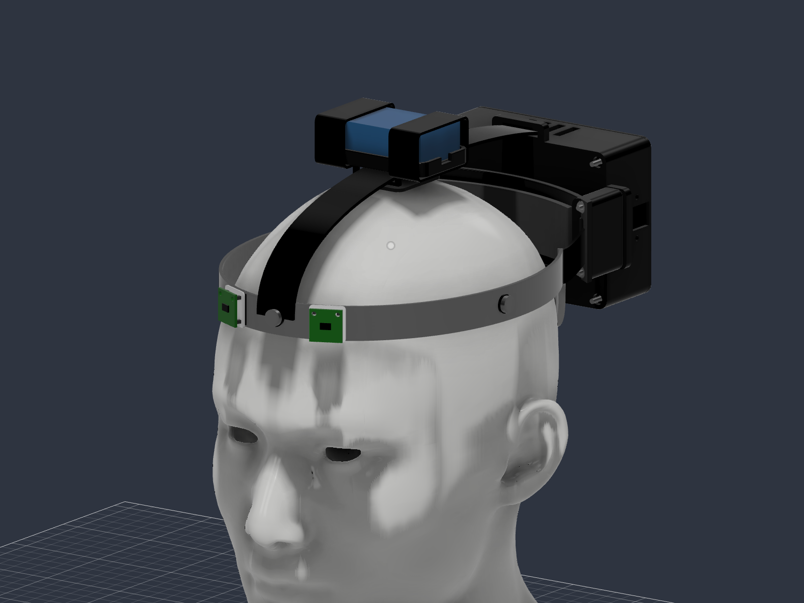
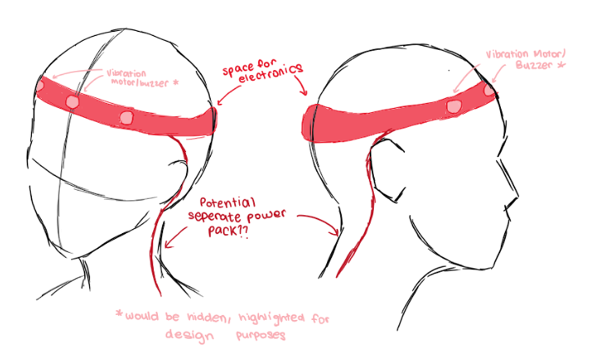
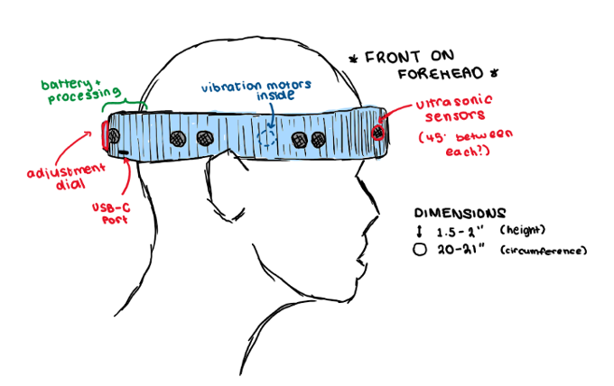
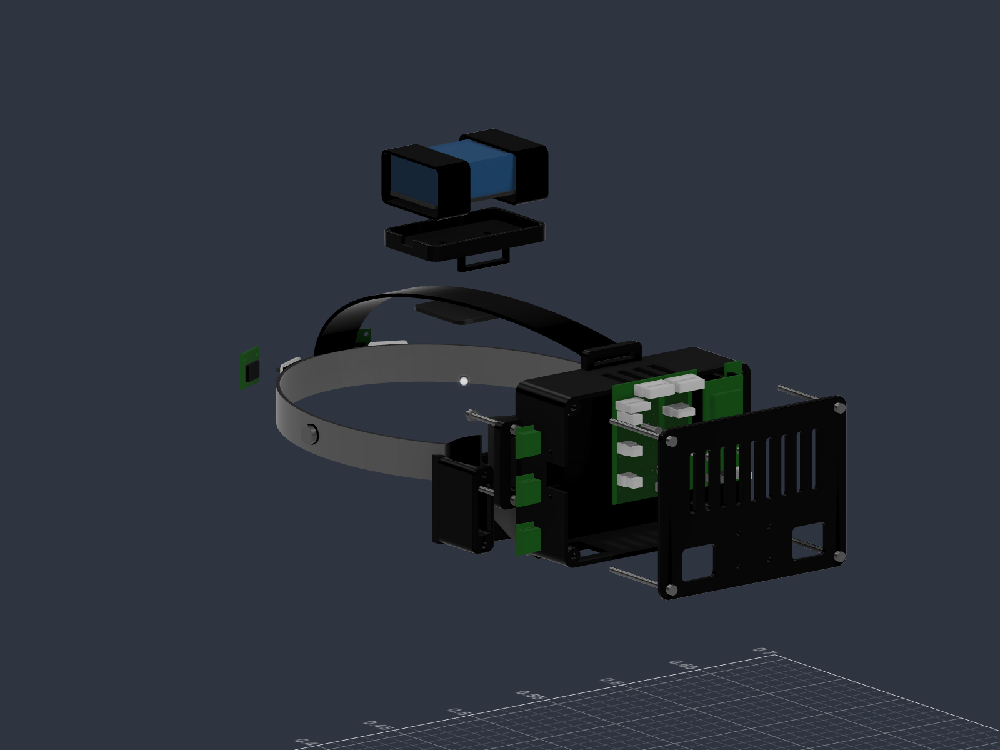
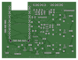

### Haptic Navigation Headband

Hello, I am Amitav. I'm making this project with Aarush (graphic designer) and Toby, who's doing the coding. This project is a headband for blind people that uses two distance sensors and three vibration motors to give feedback about nearby obstacles.

A relative of mine lost his sight through optic nerve atrophy, which got me started on this. He's our client, and we want to find out whether the vibrations are useful and the band is comfortable. The idea is extra feedback without covering his ears.

### The idea

A HUZZAH32 reads the distance sensors and controls the motors. A BNO085 measures orientation, and we're keeping Wi-Fi and Bluetooth in the plan.

We're reusing an old helmet band, with Velcro for the lighter parts and a printed housing for the PCB. The battery has a seperate holder. Trying to keep it simple to put together and not too bulky.

### Progress so far

The PCB and CAD files are here. JLCPCB reviewed the files, but the PCB order is still unpaid. We already have the HUZZAH32, sensors, BNO085, motors, switch and USB-C charger.

We haven't tested the complete device yet, and Toby's firmware isn't in the repo yet. We'll need to test for heat once the parts arrive.

Once this one works, hopefuly we can make a smaller, lighter and cheaper version.

### Drawings

These are Aarush's early sketches. Some details changed along the way.

Exploded CAD diagram :)

### PCB

The PCB connects everything, with motor drivers and external Pololu power modules.

### Files

KiCad: https://github.com/oofbaroomf/haptic-headband/tree/main/pcb

Gerbers: https://github.com/oofbaroomf/haptic-headband/blob/main/gerbers/Haptic_Headband_R3A_JLCPCB_EXPERIMENTAL_PROTOTYPE.zip

Assembly files: https://github.com/oofbaroomf/haptic-headband/tree/main/pcb/assembly

STEP: https://github.com/oofbaroomf/haptic-headband/blob/main/cad/Headband_Assembly.step

Fusion and print files: https://github.com/oofbaroomf/haptic-headband/tree/main/cad

Journal: https://github.com/oofbaroomf/haptic-headband/blob/main/JOURNAL.md

### Putting it together

Plan is to check the assembled PCB and regulator settings, test the modules on the bench, then fit everything to the printed parts and band. A proper build and flashing guide will follow once we've tried it.

### Parts

Our parts list, so we can keep track of everything while we build. We're still working out how much strap material and which mounting hardware we need.

CSV BOM: https://github.com/oofbaroomf/haptic-headband/blob/main/BOM.csv

| Part | Quantity | Reference | Link |
| --- | ---: | --- | --- |
| 4172 | 1 | U1 | https://github.com/adafruit/Adafruit-ESP32-HUZZAH-Breakout-PCB |
| DMN2056U-7 | 4 | Q1 Q2 Q3 Q5 | https://jlcpcb.com/partdetail/C332302 |
| DMP2035U-7 | 2 | Q4 Q6 | https://jlcpcb.com/partdetail/C110499 |
| 1N5819 | 3 | D1 D2 D3 | https://jlcpcb.com/partdetail/C110032 |
| MFR-25FTF52-330R | 3 | R1 R2 R3 | https://jlcpcb.com/partdetail/C1372966 |
| MFR-25FBF52-1K | 3 | R4 R5 R6 | https://jlcpcb.com/partdetail/C1364484 |
| MFR-25FTE52-100K | 1 | R12 | https://jlcpcb.com/partdetail/C172965 |
| MFR-25FTE52-10K | 4 | R10 R11 R13 R14 | https://jlcpcb.com/partdetail/C172967 |
| EEUFR1A221 | 1 | C1 | https://jlcpcb.com/partdetail/C407869 |
| EEUFM1E101 | 1 | C2 | https://jlcpcb.com/partdetail/C713389 |
| EEUFM1E101 | 1 | C3 | https://jlcpcb.com/partdetail/C713389 |
| EEUFR1A221 | 1 | C10 | https://jlcpcb.com/partdetail/C407869 |
| 805 / SS-12E17G2 | 1 | SW1 | https://cdn-shop.adafruit.com/product-files/805/SS-12E17G2-revised.pdf |
| B2B-XH-A(LF)(SN) | 3 | J1 J2 J3 | https://jlcpcb.com/partdetail/C158012 |
| B6B-XH-A(LF)(SN) | 2 | J4 J5 | https://jlcpcb.com/partdetail/C144397 |
| B6B-PH-K-S(LF)(SN) | 1 | J6 | https://jlcpcb.com/partdetail/C131342 |
| B2B-PH-K-S(LF)(SN) | 1 | J7 | https://jlcpcb.com/partdetail/C131337 |
| B3B-PH-K-S(LF)(SN) | 1 | J8 | https://jlcpcb.com/partdetail/C131339 |
| B4B-PH-K-S(LF)(SN) | 1 | J9 | https://jlcpcb.com/partdetail/C131334 |
| B5B-PH-K-S(LF)(SN) | 1 | J10 | https://jlcpcb.com/partdetail/C157993 |
| TSW-102-07-G-S | 1 | JP1 | https://jlcpcb.com/partdetail/C7402729 |
| TCA9517DR | 1 | U2 | https://jlcpcb.com/partdetail/C182421 |
| SN74CBTLV1G125DBVR | 1 | U6 | https://jlcpcb.com/partdetail/C2653264 |
| SN74LVC2G07DBVR | 1 | U3 | https://jlcpcb.com/partdetail/C37708 |
| SN74LVC1G125DBVR | 2 | U4 U5 | https://jlcpcb.com/partdetail/C23654 |
| RC1206FR-074K7L | 2 | R15 R16 | https://jlcpcb.com/partdetail/C137262 |
| RC1206FR-0710KL | 4 | R17 R18 R21 R22 | https://jlcpcb.com/partdetail/C132649 |
| RC1206FR-07100KL | 2 | R19 R20 | https://jlcpcb.com/partdetail/C137393 |
| C1206C104K5RACTU | 6 | C4 C5 C6 C7 C8 C9 | https://jlcpcb.com/partdetail/C41430990 |
| 0251002.NRT1L | 1 | F1 | https://jlcpcb.com/partdetail/C151088 |
| PHR-3 | 1 | MATE_PH3 | https://www.jst.com/wp-content/uploads/2021/08/ePH-new.pdf |
| PHR-4 | 1 | MATE_PH4 | https://www.jst.com/wp-content/uploads/2021/08/ePH-new.pdf |
| PHR-5 | 1 | MATE_PH5 | https://www.jst.com/wp-content/uploads/2021/08/ePH-new.pdf |
| PHR-6 | 1 | MATE_PH6 | https://www.jst.com/wp-content/uploads/2021/08/ePH-new.pdf |
| XHP-2 | 3 | MATE_XH2 | https://www.jst.com/wp-content/uploads/2025/06/eXH.pdf |
| XHP-6 | 2 | MATE_XH6 | https://www.jst.com/wp-content/uploads/2025/06/eXH.pdf |
| ASPHSPH24K305 | 10 | CONTACT_PH | https://www.digikey.co.uk/en/products/detail/jst-sales-america-inc/ASPHSPH24K305/6009459 |
| ASXHSXH22K305 | 10 | CONTACT_XH | https://www.digikey.co.uk/en/products/detail/jst-sales-america-inc/ASXHSXH22K305/6684932 |
| SSW-115-01-T-S | 2 | SK1 SK2 | https://jlcpcb.com/partdetail/C6686518 |
| PIM622 | 2 | TOF_LEFT TOF_RIGHT | https://cdn.shopify.com/s/files/1/0174/1800/files/VL53L5CX-schematic.pdf?v=1654004213 |
| 4754 (selected; confirm purchased SKU) | 1 | IMU1 | https://learn.adafruit.com/adafruit-9-dof-orientation-imu-fusion-breakout-bno085/pinouts |
| S7V8F3 / 2122 | 1 | REG_SENS | https://www.pololu.com/product/2122 |
| S7V8A / 2118 | 1 | REG_MOTOR | https://www.pololu.com/product/2118 |
| Reference only: 10B27.3018 / Adafruit1201 | 3 | M_LEFT M_RIGHT M_FRONT | https://thepihut.com/products/vibrating-mini-motor-disc |
| ICR18650 4400mAh 3.7V | 1 | BAT1 | https://shop.pimoroni.com/products/lithium-ion-battery-pack?variant=23417820423 |
| S7V8A / 2118 | 1 | REG_CTRL | https://www.pololu.com/product/2118 |
| 4410 | 1 | CHARGER1 | https://www.adafruit.com/product/4410 |
| M7566-05 | 1 | JP1_SHUNT | https://www.harwin.com/products/M7566-05 |
| HB-VIN-JUMPER-01 (assembly drawing, not vendor MPN) | 1 | HARNESS_CTRL | Custom wire/link |
